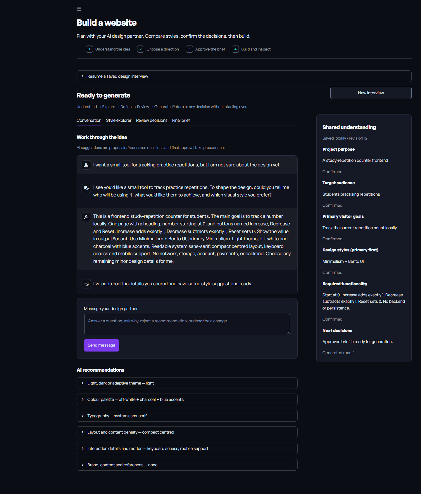

# Synthetix

**Plan the website. Build it. Test the behaviour. Review the repair.**

Synthetix is a local AI-assisted website builder and code-repair workspace. It uses **NVIDIA Nemotron through Nebius Token Factory** to collaborate on a design brief, generate self-contained HTML/CSS/JavaScript, inspect it in Chromium and attempt repairs when selected checks fail.

[Use online](https://praharsh1409.github.io/synthetix/app.html) · [Project website](https://praharsh1409.github.io/synthetix/) · [How it works](#how-it-works) · [Windows setup](#windows-setup) · [Testing](#testing)



## What you can do

- **Build:** describe an idea, answer one question at a time using three AI suggestions or a custom answer, then choose a design direction from the 15 supported styles. Saved answers move the interview forward automatically.
- **Review the website:** approving the exact final brief starts generation and opens the review page. The supplied Synthetix logo animates while real work is running. Percentage progress counts five completed stages, not elapsed time; completion requires saved HTML and a passing browser report. Inspect the actual preview and export the HTML here.
- **Repair:** import HTML, inspect runtime errors, describe intended behaviour, review browser assertions, then attempt a repair and rerun the same checks.
- **Run locally:** serve a self-contained webpage on your computer without AI changes to its source.
- **Review:** inspect versions, screenshots, diagnostics and code differences; restore an earlier version as an untested draft and download HTML.

The design interview supports Minimalism, Maximalism, Glassmorphism, Neumorphism, Claymorphism, Brutalism, Neo-Brutalism, Skeuomorphism, Flat Design, Material Design, Bento UI, Y2K Design, Retro Design, Cyberpunk and Editorial Design. Compatible combinations are supported; unusual combinations show trade-offs. Recommendations remain editable proposals.

## How it works

```text
Describe / import
      ↓
Clarify requirements → review decisions → approve brief or behaviour checks
      ↓
Generate / inspect → run in isolated Chromium → collect evidence
                          ↑                       ↓
                          └──── attempt repair ───┘
      ↓
Review source, versions, screenshots and reports → export / run locally
```

Repairs are bounded to three attempts. A runtime-only pass means no runtime failure was observed within the test window. Behaviour assertions are needed to verify intended functionality; neither result certifies every interaction, appearance or device.

## Use online

Open [Synthetix on the project website](https://praharsh1409.github.io/synthetix/app.html), or [open the app directly](https://synthetix-workspace.streamlit.app/).

The online entry point is `cloud_app.py`. It gives each visitor an unguessable, server-managed temporary workspace. AI workflows use the visitor's Nebius key, entered in the password field and passed only to that visitor's worker process. The owner's environment key is never a fallback. Keys are not saved in requests, project files or the repository. Browser inspection and Run HTML do not require a model key.

Online HTML runs in the existing isolated browser preview; the app does not give remote visitors unusable `127.0.0.1` links. Download HTML to keep it or run it locally. Sessions are temporary: refreshing, disconnecting, hibernation or redeployment can lose access. This release does not provide accounts, permanent storage or a production service guarantee.

### Free Community Cloud deployment

Deploy `Praharsh1409/synthetix`, branch `main`, entry point `cloud_app.py`, Python 3.12. No owner API secret is required. `packages.txt` installs Debian Chromium and its sandbox helper. Chromium sandboxing stays enabled; a host that cannot support it must return an execution failure rather than disable the protection. An installed system browser can differ from Playwright's bundled version and must be verified on the target host.

Only one hosted worker runs at a time. A ten-minute worker deadline and a 25 MB visitor-workspace limit bound individual jobs. These controls supplement the offline browser, filtered environment and CSP; they are not full OS isolation or a denial-of-service guarantee. Do not upload secrets or private source to a public demo host. Free hosting has resource limits and can sleep. AI provider usage is billed to the key owner.

## Windows setup

Validated with **Python 3.12 on Windows**. Other operating systems have not been verified for this release.

```powershell
git clone https://github.com/Praharsh1409/synthetix.git
cd synthetix
py -3.12 -m venv .venv
.\.venv\Scripts\python.exe -m pip install --upgrade pip
.\.venv\Scripts\python.exe -m pip install -r requirements.txt
.\.venv\Scripts\python.exe -m playwright install chromium
Copy-Item .env.example .env
```

Edit `.env` in your editor and set your own `NEBIUS_API_KEY`. Never commit the real key.

```powershell
.\.venv\Scripts\python.exe -m streamlit run app.py
```

Open **http://127.0.0.1:8501/**. The default listener is restricted to your computer. The model must be available to your Nebius account; the configured ID is `nvidia/NVIDIA-Nemotron-3-Nano-30B-A3B`.

AI conversations, generation, test planning and repair use your Nebius credits. Local browser inspection, hosting, tests and the static website's illustrative counter make no model calls.

## Testing

```powershell
.\.venv\Scripts\python.exe -m unittest discover -s tests -v
.\.venv\Scripts\python.exe -m pip check
.\.venv\Scripts\python.exe demo_self_heal.py --check-only
```

The regression suite uses temporary artifacts, Chromium, isolated Streamlit tests and controlled API responses. It does not require a live API key. Validation before this release on October 28, 2026: **95 tests passed**. This is a dated validation result, not a live benchmark or a guarantee of generated-site quality.

Guided-flow verification on October 29, 2026: **116 tests passed**, including saved single-question answers, custom-answer recovery, extraction before question selection, approval-triggered generation, stage-based progress, compact completion, and saved-site recovery. Live model and browser acceptance checks are reported separately from these controlled regression tests.

## Architecture

| Component | Responsibility |
|---|---|
| `app.py`, `interview_ui.py`, `workspace_ui.py` | Streamlit navigation, planning and code workspace |
| `design_interview.py`, `design_styles.py` | Persistent requirements, recommendations and approval gates |
| `guided_interview.py`, `generation_ui.py` | One-decision interview transitions, three AI suggestions plus custom answers, and real generation-stage progress |
| `ui_worker.py` | Model and browser operations outside the UI event loop |
| `nebius_tasks.py`, `generate_ui.py`, `self_heal.py` | Nebius/Nemotron integration |
| `synthetix.py` | Generation, check, bounded repair and retest pipeline |
| `browser_safety.py`, `intent_checks.py`, `counter_check.py` | Browser isolation and declarative assertions |
| `project_store.py`, `artifact_io.py`, `reporting.py` | Checkpoints, history and honest verdicts |
| `hosting.py`, `local_host.py`, `web_documents.py` | Loopback-only hosting and isolated previews |

Planning conversations and saved runs are stored in `artifacts/` on your computer. They are excluded from this repository. If AI suggestions fail, already saved answers remain available and a custom answer or explicit retry can continue the interview. Changing requirements requires fresh brief approval. Website generation is not automatically retried on page rerenders.

## Scope and security

- Generates one self-contained HTML file with inline CSS/JavaScript. Multiple views can live inside that file.
- Does not implement real payments, authentication, databases or email backends.
- Treats uploaded/generated pages as untrusted. Chromium checks restrict network access; previews and hosted pages use opaque sandboxed frames and content security policies.
- Keeps API keys server-side and filters browser-process environment variables. External assets, cross-origin APIs, navigation and some storage features are intentionally restricted.
- Uses explicit timeouts and bounded diagnostics, inputs and allocations. These controls are **not** a complete OS/container or CPU/RSS/GPU quota system.
- The local entry point remains single-user. The online entry point provides temporary visitor isolation and bring-your-own-key access; it does not provide authenticated accounts, durable storage or full operating-system isolation.
- AI extraction, style rankings and test proposals can be wrong. Review the decisions and assertions before approving them.

## GitHub Pages

The `docs/` directory contains the public project website and `app.html`, which embeds the real Streamlit app using the supported `?embed=true` URL. GitHub Pages serves the shell; Streamlit Community Cloud runs Python and Chromium. The separate counter illustration remains labelled as scripted. The direct-app link is available if a browser blocks embedded apps.

Publish the website from **Settings → Pages → Deploy from a branch → main → /docs**. The `.nojekyll` file keeps it a plain static site. All website assets use relative paths, including when served under `/synthetix/`.

The source repository includes no personal `.env`, virtual environment, conversations, saved projects, backups or internal audit logs. Third-party model access and browser downloads are separate from the source code.
